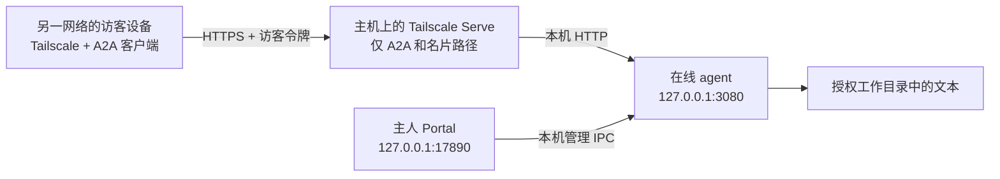

# 用 Tailscale 从不同网络访问 A2A agent

本教程适用于：agent 在家中电脑运行，你在公司、旅行途中或手机热点下访问；或者把这台电脑上的 agent 分享给指定朋友。

采用 **Tailscale Serve + HTTPS**：主机上的 agent 只监听本机地址，由 Tailscale 转发两个 A2A 路径。访问者需要连接 Tailscale、获得设备访问权限，并持有自己的 A2A 访客令牌。[Serve 官方说明](https://tailscale.com/docs/features/tailscale-serve)



这里的跨网络访问不需要路由器端口映射、公网 IP、自购域名、子网路由器或 exit node。普通未获准的互联网访客不能使用这个 Serve 地址。Funnel 是另一种公网发布方式，本教程不启用它。

## 0. 先让本机 agent 运行起来

按 [README 的首次启动](../README.md#首次安装与启动)完成配套源码插件安装，在 Portal 里确认：

| 项目 | 本教程的值 |
| --- | --- |
| 网络模式 | 自定义地址 |
| 对外地址（初次验证） | `127.0.0.1` |
| 本地端口 | `3080`，后文所有本地 URL 随实际端口一起改 |
| 访客 | 有独立令牌，并勾选允许对话和读取指定工作目录 |
| 工作区 | 你指定的可分享资料目录 |
| 运行状态 | 在线 agent 运行中 |

在主机上检查名片：

```powershell
# Windows PowerShell
curl.exe http://127.0.0.1:3080/.well-known/agent-card.json
```

macOS/Linux 把 `curl.exe` 换成 `curl`。这一步失败时先修复本地启动或端口配置，Tailscale 不能代替 agent 运行。

## 1. 两端安装并连接 Tailscale

**主机和发起 A2A 请求的设备都需要安装。** 如果访客是在云端运行的 agent，Tailscale 也必须接入那台云端机器；只在访客的浏览器电脑安装并不够。

| 系统 | 安装与登录 |
| --- | --- |
| Windows | 从 [官方下载页](https://tailscale.com/download)安装 Windows 客户端，在托盘图标中登录；完成后重新打开终端 |
| macOS | 从[官方下载页](https://tailscale.com/download)安装 macOS 客户端，允许系统要求的网络扩展并登录；按对应发行版说明启用 CLI |
| Linux | 按[官方 Linux 安装说明](https://tailscale.com/docs/install/linux)安装，然后运行 `sudo tailscale up`，打开命令给出的登录链接 |

自己的两台设备登录同一个 tailnet。其他人的设备请邀请加入你的 tailnet，或只共享运行 agent 的这一台机器；朋友使用自己的账号，不需要你的登录密码。安装流程参见[官方快速入门](https://tailscale.com/docs/how-to/quickstart)。

只共享一台机器的方法：打开 [Tailscale Machines](https://login.tailscale.com/admin/machines)，找到 agent 主机，选择 **Share**，生成邀请链接；交给指定朋友，让对方登录自己的账号并接受。之后对方可以在 Tailscale 中看到这台共享设备。共享仍受访问策略约束；共享设备的 DNS 名称应使用完整的 `主机名.tailnet名.ts.net`。[设备共享说明](https://tailscale.com/docs/features/sharing)

两边分别确认已连接：

```sh
tailscale status
tailscale ip -4
```

`tailscale ip -4` 输出的是当前这台设备的地址。记下 **agent 主机**的地址，例如 `100.101.102.103`，从访客设备检查网络连通：

```sh
tailscale ping 100.101.102.103
```

这个例子里的 IP 需要换成实际值。Ping 有回复只证明 Tailscale 链路可达，不代表应用端口或令牌已经通过验证。

Windows 如果提示找不到命令，可先重新开终端，或运行 `& 'C:\Program Files\Tailscale\tailscale.exe' status`；安装到其他目录时使用实际路径。

## 2. 只转发 A2A 接口

在 **agent 主机**执行以下命令。先查看已有配置：

```sh
tailscale serve status
```

如果 HTTPS 443 已用于其他 Serve 或 Funnel 服务，不要覆盖。可以选择另一个未占用的 HTTPS 端口，例如 `8443`，把下面所有 `--https=443` 换成 `--https=8443`，之后对外 URL 也要带上 `:8443`。不要为此执行全局 `tailscale serve reset`。

```sh
tailscale serve --bg --https=443 --set-path=/a2a http://127.0.0.1:3080/a2a
tailscale serve --bg --https=443 --set-path=/.well-known/agent-card.json http://127.0.0.1:3080/.well-known/agent-card.json
tailscale serve status
```

若提示需要管理员权限，Windows 使用管理员终端，Linux 在命令前加 `sudo`。首次使用按提示链接启用所需的 HTTPS 配置；如需管理员批准，交由 tailnet 管理员处理。[HTTPS 与访问规则](https://tailscale.com/docs/features/tailscale-serve)

目标 URL 末尾的 `/a2a` 和 `/.well-known/agent-card.json` **都要保留**。Serve 按挂载路径转发时会移除匹配前缀，目标 URL 再补回真实的后端路径；写成只有 `http://127.0.0.1:3080` 会转发到错误的位置。[命令参考](https://tailscale.com/docs/reference/tailscale-cli/serve)、[上游转发实现](https://github.com/tailscale/tailscale/blob/main/ipn/ipnlocal/serve.go)

`status` 应显示本机实际的 HTTPS 域名，以及上述两条路径，目标端口都是 `3080`。例如域名可能是 `https://my-pc.example-tailnet.ts.net`，以实际输出为准。

DSH 的同一个 Web 端口还可能提供自己的 UI/API，因此不要用没有 `--set-path` 的整站转发来代替上述两条命令。Portal 的 `17890` 端口也不需要转发。其他已有 Serve 规则保持独立，必须一起检查才能确认整台机器的实际暴露范围。

## 3. 把 HTTPS 地址写回 Portal

主机 Portal → 当前 agent →「编辑配置」→「网络」：

| 字段 | 示例 |
| --- | --- |
| 模式 | 自定义地址 |
| 对外地址 | `https://my-pc.example-tailnet.ts.net`，用 `status` 的实际值替换 |
| 端口（dsh web 服务监听端口） | `3080` |
| 访客最终访问地址 | `https://my-pc.example-tailnet.ts.net/a2a` |

如果 Serve 用的是 `8443`，对外地址填 `https://my-pc.example-tailnet.ts.net:8443`；本地端口仍是 `3080`。完整 HTTPS URL 的端口和本地监听端口是两个不同的设置。

点「保存」，回控制台先「停止」再「启动」，让 agent 名片里的 RPC URL 更新。完整 HTTPS 域名模式默认把 agent 绑定到 `127.0.0.1`，适合上面的本机转发；已有手工设置 `network.bindHost` 的配置需要确认同样为回环地址。

Tailscale 的访问策略还需要允许该访客访问 agent 主机的 TCP `443`（或你选的 `8443`）。若管理员已经限制过网络，请在原有策略上授权这个目标和端口，不要把整个策略替换成允许所有流量。共享机器也遵守拥有该机器的 tailnet 策略。[共享与访问控制](https://tailscale.com/docs/features/sharing)

## 4. 在另一网络验证并开始对话

把访客电脑切到手机热点，主机保持原来的网络，两端都连接 Tailscale。这个检查能排除“其实只在同一 Wi-Fi 可用”的情况。

先在访客设备读取名片，Windows PowerShell：

```powershell
Invoke-RestMethod 'https://my-pc.example-tailnet.ts.net/.well-known/agent-card.json' | ConvertTo-Json -Depth 10
```

macOS/Linux：

```sh
curl --fail --show-error https://my-pc.example-tailnet.ts.net/.well-known/agent-card.json
```

名片中的 `supportedInterfaces` URL 应指向 **HTTPS 域名下的 `/a2a`**，而不是 `127.0.0.1` 或旧的局域网地址。另检查根路径 `/` 不出现 DSH/Portal 管理页面；在没有其他 Serve 配置的本教程环境中，它应返回 404。

接着验证访客身份和模型响应。访客设备只需要 Node.js 和本仓库，无需运行 Portal 或安装 dsh。在访客设备的 `Talk2MyAgent` 根目录设置令牌：

```powershell
# Windows PowerShell：替换成主人为你生成的访客令牌
$env:A2A_PEER_HOME_AGENT = '替换为你的访客令牌'
```

```sh
# macOS/Linux：二选一，只执行自己系统对应的设置
export A2A_PEER_HOME_AGENT='替换为你的访客令牌'
```

然后执行，两种系统的命令相同：

```sh
node packages/a2a-skill/bin/a2a.mjs add home-agent https://my-pc.example-tailnet.ts.net/a2a A2A_PEER_HOME_AGENT
node packages/a2a-skill/bin/a2a.mjs card home-agent
node packages/a2a-skill/bin/a2a.mjs send home-agent "请介绍你能做什么，并概括当前公开简报。"
```

发送消息会调用主机配置的模型。再让它读取授权目录中一个已知文件，例如询问 `README.md` 的内容，确认工作目录配置正确。若返回未完成状态，记下实际任务 ID 后查询：

```sh
node packages/a2a-skill/bin/a2a.mjs task home-agent <实际任务ID>
```

替换尖括号占位符后再执行。CLI 通讯录保存的是环境变量名，令牌值来自当前终端环境；新开终端后需重新设置。主人的 Portal 应能看到这位访客的问题与答复。

交给访客的信息有三项：设备访问授权（同 tailnet 或设备共享）、HTTPS A2A URL、该访客专属令牌。浏览器直接打开 `/a2a` 不是聊天入口；它接受 A2A RPC POST，请使用上述 CLI 或其他 A2A 客户端。

## 5. 关于 `100.x` 地址直连

Portal 也支持在自定义地址中填主机的纯 Tailscale IPv4，例如 `100.101.102.103`，本地端口 `3080`；此时会直接绑定这张网卡，访客访问 `http://100.101.102.103:3080/a2a`。这里填写纯 IP，**不要加 `http://` 或 `/a2a`**，否则当前的监听地址推导会按完整 URL 选择回环监听，无法按这个直连方式访问。

直连要求 Tailscale 网卡已存在，访问策略和主机防火墙允许该端口；HTTP 流量经过 Tailscale 加密网络传输。它会让获准访问这个端口的设备同时接触 DSH 的其他 Web 路径，因此更适合自己的受信任设备。给朋友分享 A2A 时使用上面的路径受限 Serve 配置。两种方式不要混用：Serve 后端是回环地址，直连后端绑定 `100.x` 地址。

## 6. 常见问题

| 现象 | 检查方式 |
| --- | --- |
| 另一网络连不上，`tailscale status` 看不到主机 | 确认两端在线、加入正确 tailnet 或已接受共享，设备未过期，主机没有睡眠 |
| `tailscale ping` 有回复，但 HTTPS 超时 | 检查目标 TCP 443/8443 的访问策略、Serve 状态；Ping 不是应用端口验收 |
| 域名无法解析 | 确认客户端使用 Tailscale DNS、MagicDNS 可用；共享设备使用完整 `.ts.net` 名称；检查其他 VPN/代理的 DNS 设置。[MagicDNS](https://tailscale.com/docs/features/magicdns) |
| HTTPS 返回 502 | 主机执行本地名片检查，确认 agent 在运行、监听 `127.0.0.1`、端口与 Serve 目标一致 |
| 名片 404，或 RPC 请求到了首页 | 核对两条 Serve 路径及目标 URL 后缀；确认 A2A 插件成功安装；不要只转发 `/a2a` 而漏掉名片 |
| 名片返回旧 IP | Portal 保存网络配置后重启 agent，再检查 `supportedInterfaces` |
| A2A 请求 401 | 网络已接通；检查访客令牌和环境变量，不能使用主人令牌或模型 API Key |
| A2A 请求 403 | 检查 Portal 中该访客是否获准对话和读取；另核对响应来自 Tailscale 还是 A2A 服务 |
| 名片正常，聊天失败 | 查看主机模型凭据、模型名称、任务状态和日志；名片获取不调用模型 |
| 发给朋友仍不可用 | 对方接受共享且发起请求的那台设备已接入 Tailscale；只有 URL 和令牌不够 |
| 重启后不通 | `--bg` 的 Serve 配置会恢复，但还需重新启动在线 agent；也检查 Tailscale 登录与主机电源状态 |

## 7. 停止访问或撤销分享

只移除本教程新增的两个转发，端口与前面的配置保持一致：

```sh
tailscale serve --https=443 --set-path=/a2a off
tailscale serve --https=443 --set-path=/.well-known/agent-card.json off
tailscale serve status
```

不需要清空其他 Serve 配置。只撤销某个访客时，在 Tailscale Machines 中撤销设备共享，同时在 Portal 移除或取消允许该访客，保存并重启 agent；令牌需要轮换时也在 Portal 修改。关闭 Portal 页面不会停止 agent，停止整个 agent 请使用 Portal 的「停止」。[Serve 关闭与后台运行规则](https://tailscale.com/docs/reference/tailscale-cli/serve)

本教程于 2026-10-26 对照项目当前配置逻辑、Tailscale 官方文档和 CLI 帮助核对。文档维护过程中没有修改真实 tailnet 配置，也没有完成两台物理设备的跨网络实测；第 4 节是部署者需要执行的验收步骤。
